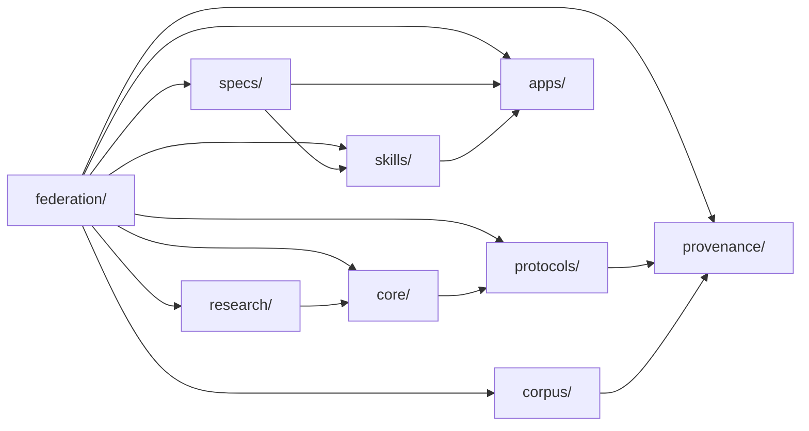

# Architecture

The hub stays a single repository. Imported projects keep their own trees under a layer directory. Draft imports are listed in [federation/COMPONENTS.md](../federation/COMPONENTS.md) and in [`sovereign.toml`](../sovereign.toml). `python -m sovereign status` prints each component path and whether that directory is on the current checkout.

This branch does not merge those drafts. A path is present only after its draft lands on `main`.

| Layer | Role | Draft paths |
| --- | --- | --- |
| `core/` | Method, OMEGA-10, and OmniNet | `core/method`, `core/omega-10`, `core/omninet` |
| `protocols/` | Phoenix and multi-AI convergence | `protocols/phoenix`, `protocols/convergence` |
| `specs/` | CZAOUA and WE-OMEGA specifications | `specs/czaoua`, `specs/we-omega` |
| `skills/` | Skill lattice | `skills/lattice` |
| `apps/` | Android client and Zyth UI | `apps/android`, `apps/zyth-ui` |
| `research/` | ZAAI notes and experiments | `research/zaai` |
| `provenance/` | AGSI archive and OpenTimestamps proofs | `provenance/agsi-archive` |
| `corpus/` | Dated math and achievement corpus | `corpus/2026-10-16` ([#10](https://github.com/Zygros/conzet-sovereign-intelligence/pull/10)) |
| `federation/` | Index, component map, and upstream credits | `federation/` |

`python -m sovereign` is the shared command surface:

- `status` reads `sovereign.toml` and lists components.
- `verify-math` recomputes the GAIA probability and the phi claims with mpmath.
- `verify-ots` runs `ots verify` on `provenance/**/*.ots` and reports pending when no node answers.
- `phoenix-bench` runs the OMEGA-10 Phoenix benchmark when `core/omega-10` contains it.
- `test` runs the hub pytest collection (`tests/` and `genesis/`) and any pytest suite present under a component path.
