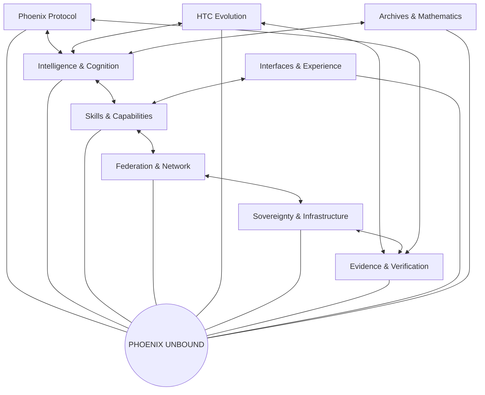

# Phoenix Unbound
## Sacred-geometry architecture and repository federation

**Status:** Architecture specification (proposal; not a deployed runtime)  
**Origin:** Phoenix Protocol  
**Design rule:** Peer-to-peer, non-hierarchical composition. No repository is the parent of another repository.

Phoenix Unbound is the encompassing architecture for the user's Phoenix ecosystem. Existing repositories remain independent source projects with their own histories. They participate as organs and capabilities through explicit, versioned interfaces. This document does not move, merge, rename, or delete repositories.

## Geometric constitution

- **Flower of Life — participation:** every repository, model, skill, service, and evidence source is represented as a peer node. Overlap represents shared capability or collaboration.
- **Metatron's Cube — connectivity:** edges represent typed, authenticated, observable interfaces. The graph is many-to-many, not a tree.
- **Vesica Piscis — interoperability:** shared contracts define the overlap between two or more organs without requiring identical implementations.
- **Tetragrammaton — fourfold operating cycle:** a symbolic four-part design motif for the system's operating rhythm: **Conceive → Connect → Execute → Verify**. This is a design convention, not a claim of supernatural or computational effect.
- **Toroidal circulation — feedback:** verified outputs, evaluations, and learning signals can return to participating organs through explicit feedback channels.
- **Golden ratio — optional visual proportion:** may guide visual composition; it is not presumed to improve model performance.

## Phoenix anatomy: peer organs

These are functional domains, not parent/child folders or authority levels. A repository may contribute to several organs.

| Organ | Responsibilities | Example source families |
|---|---|---|
| Phoenix Protocol | execution primitives, runtime contracts, original protocol | Phoenix Protocol repositories |
| Intelligence & Cognition | model inference, reasoning, planning, memory | ZAAI, CIS, Conzetian intelligence projects |
| Skills & Capabilities | tools, plugins, reusable skills, adapters | skill lattice and plugin repositories |
| Federation & Network | agent discovery, A2A, event exchange, distributed execution | OmniNet, federation, gateway projects |
| HTC Evolution | training orchestration, datasets, evaluations, checkpoints | HTC/HCC scripts and benchmark projects |
| Sovereignty & Infrastructure | identity, policy, local runtime, servers, deployment manifests | mobile node, server and infrastructure repositories |
| Evidence & Verification | tests, receipts, hashes, provenance, reproducibility | audit, OTS, evidence-chain projects |
| Interfaces & Experience | dashboards, CLI, mobile UI, operator experience | dashboard and application repositories |
| Archives & Mathematics | scrolls, research, formal models, historical records | documentation and mathematics repositories |

## Network model

`Phoenix Unbound = (V, E, C, P)`

- `V`: registered peer organs and capability nodes.
- `E`: typed connections between nodes.
- `C`: versioned contracts and schemas.
- `P`: policy, permissions, provenance, and verification rules.

A node can connect to multiple peers. A connection is enabled only when its contract, authentication, authorization, and health checks pass. No single model vendor is required to be the permanent runtime authority.

## Visual topology

All spokes are peers around a shared center; cross-links are first-class. The drawing is a conceptual topology, not a claim that all connections currently exist.

## Model composition: three Phoenix files

The three model files described by the user are treated as three components of one intended Phoenix model system, not as competing generations. Before combining weights or training them together, inventory each file's format, architecture, tensor shapes, tokenizer, configuration, license, and provenance.

Composition options, selected only after inspection:
1. **Shared inference facade:** route requests to compatible components behind one model interface.
2. **Pipeline composition:** assign complementary stages to separate components.
3. **Adapter composition:** connect compatible components using explicit adapters.
4. **Weight merge or shared training:** only if architecture, tensor layout, tokenizer, licensing, and training method are demonstrably compatible.

Never average or merge unknown/incompatible weights. Preserve immutable source copies and record hashes for every derived artifact.

## Capability contract

Every capability is registered with:
- stable identifier and semantic version;
- owner/source repository and immutable commit reference;
- input/output schema;
- transport (local function, stdio, HTTP, A2A, event);
- authentication and authorization requirements;
- required permissions and declared side effects;
- health/readiness check;
- timeout, retry, and resource limits;
- test suite and evidence references;
- license and provenance.

See `capability-registry.schema.json` and `model-adapter-contract.md`.

## Security and sovereignty

- Local-first control plane; remote services are optional peers.
- Least-privilege credentials; never place secrets in manifests or source control.
- Explicit consent for destructive actions, external publication, payments, deployment, or infrastructure changes.
- Sandboxed execution for untrusted skills and model-generated code.
- Resource budgets, request limits, audit trails, revocation, and offline mode.
- No claim of “unbounded” compute or capability: hardware, network, licenses, permissions, and safety constraints remain real engineering limits.

## Delivery sequence

1. Inventory every repository and artifact; preserve source histories.
2. Populate the registry with evidence-backed node records.
3. Validate interfaces and identify duplicate/overlapping capabilities.
4. Implement read-only discovery and graph visualization.
5. Add authenticated, permission-scoped connections.
6. Integrate the three Phoenix model components after compatibility inspection.
7. Run HTC training/evaluation with reproducible datasets, checkpoints, metrics, and rollback.
8. Promote integrations only after tests and human review.

## Acceptance criteria

- Every known repository has a stable node record or an explicit exclusion reason.
- No repository history is destroyed or silently rewritten.
- All enabled edges reference a versioned contract and pass integration tests.
- All capabilities declare permissions, side effects, provenance, and health checks.
- Model composition has a reproducible compatibility report and source hashes.
- HTC results include dataset/version, config, seed, hardware, checkpoint hash, and raw metrics.
- The interface renders a peer network, not a hierarchy.
- Offline/local operation and credential revocation are tested.

## Current implementation status

This document defines the target architecture. It does not claim that repositories have already been physically consolidated, that all peers are connected, that the three model files have been merged, or that HTC training has run. Those are subsequent implementation milestones tracked with evidence.
