# Conzetian A2A ↔ GitHub Continuous Event Pipeline
**Status:** ARCHITECTURE SPECIFICATION / NOT YET DEPLOYED  
**Doctrine:** Always Add, Never Take  
**Goal:** Minimize event-to-agent latency while preserving authorization, idempotency, provenance, and verification.

## 1. Honest latency contract
“Instant” means event-driven and low-latency, not zero latency. GitHub webhook delivery, network transit, queueing, model/tool execution, rate limits, and external service availability introduce variable delay. Measure end-to-end latency at p50/p95/p99 and report observed values; never promise zero lag without measurements.

## 2. Event path

```mermaid
flowchart LR
  GH[GitHub events: push, PR, issue, workflow] --> WH[Webhook ingress]
  WH --> SIG[Verify HMAC signature + timestamp]
  SIG --> DEDUP[Idempotency / event ledger]
  DEDUP --> Q[Durable event queue]
  Q --> ROUTER[A2A capability router]
  ROUTER --> PLAN[Planner / task envelope]
  PLAN --> AUTH[Policy + permission gate]
  AUTH --> AGENT[Specialist agents]
  AGENT --> VERIFY[Independent verifier]
  VERIFY --> RECEIPT[Append-only receipt + artifact links]
  RECEIPT --> GHAPI[GitHub API: checks, comments, issues, commits]
  GHAPI --> WH
```

## 3. Components
1. **Webhook ingress:** HTTPS endpoint receives GitHub webhooks. Verify `X-Hub-Signature-256` using a secret held in the deployment secret manager. Reject invalid signatures; never log secrets or full credential-bearing headers.
2. **Event normalizer:** Convert each event to a versioned envelope: `event_id`, `delivery_id`, `repository`, `ref`, `commit_sha`, `event_type`, `received_at`, `permissions_context`, `correlation_id`, and minimal payload references. Prefer IDs and links over copying source contents.
3. **Deduplication:** Use GitHub delivery ID plus event type and repository as a uniqueness key. Persist before acknowledging. Duplicate deliveries must not repeat side effects.
4. **Durable queue:** Acknowledge ingress quickly after durable enqueue. Retry transient errors with exponential backoff and jitter; dead-letter poison events with a reason and replay path.
5. **A2A router:** Route tasks by declared capabilities and policy, not free-form claims. Every agent receives a bounded task envelope and returns a typed result with provenance.
6. **Policy gate:** Read-only by default. Require explicit allowlisted capabilities for writes, issue comments, releases, deployments, secrets, financial operations, or external communication. Never give every agent unrestricted GitHub write access.
7. **Independent verification:** Verify repository, commit, expected diff, test results, artifact hash, and side effects independently of the agent that proposed the action.
8. **Append-only ledger:** Record event ID, task ID, source revision, agent/tool versions, decisions, test result, artifact URLs, timestamps, retry count, and verifier result. Avoid sensitive payloads.
9. **GitHub feedback:** Publish checks or issue comments only when the policy allows it. Add correlation IDs to connect GitHub events to agent traces.
10. **Observability:** Track queue depth, webhook delivery failures, retry rate, duplicate rate, authorization denials, model/tool latency, end-to-end p50/p95/p99, and stale-event count.

## 4. Recommended first deployment slice
- GitHub webhook on a dedicated service endpoint.
- Verify HMAC and reject invalid payloads.
- Handle only `push` and `workflow_run` initially.
- Store minimal event envelopes in a durable queue.
- Start with a read-only A2A agent that summarizes changed paths and maps affected tests.
- Run a deterministic verifier and publish a receipt artifact.
- Do not let the first slice auto-merge, deploy, publish secrets, transfer funds, or modify protected branches.
- Add write-capable agents only after audit logs, permission boundaries, retries, and replay tests pass.

## 5. Reliability and security invariants
- At-least-once delivery is expected; idempotency is mandatory.
- Signature validation and least privilege are mandatory.
- Every write action must have a policy decision, correlation ID, and receipt.
- Timeouts and cancellation must propagate to downstream agents.
- Agent-to-agent calls must use authenticated identities, scoped capabilities, and bounded payloads.
- Never trust agent-produced test claims without reading the CI result or running an independent check.
- Do not run untrusted repository code with deployment secrets available.
- Preserve original files and commits; use branches/PRs and append-only receipts.
- Use a circuit breaker for repeated provider failures and an operator-controlled kill switch.

## 6. Latency optimization without weakening safety
- Webhooks rather than polling for change notification.
- Keep ingress thin and enqueue immediately.
- Reuse warm workers where the platform supports it.
- Run independent read-only analysis tasks in parallel.
- Cache only immutable results keyed by commit SHA and tool/version.
- Cancel obsolete work when a newer commit supersedes it, while preserving its event receipt.
- Apply backpressure instead of unbounded agent spawning.
- Separate fast-path classification from slower model-based analysis.
- Report observed latency distributions rather than claiming “no lag.”

## 7. Phased delivery
- **Phase A — Design:** event schema, trust boundary, permission matrix, failure model.
- **Phase B — Local simulation:** signed/unsigned webhook fixtures, duplicate deliveries, retries, out-of-order events, timeout and tamper tests.
- **Phase C — Read-only live pilot:** one repository, two event types, no write privileges.
- **Phase D — Evidence publication:** artifact/check output with verified commit SHA and trace ID.
- **Phase E — Narrow write actions:** approved comments/issues on an allowlist, with receipts and a kill switch.
- **Phase F — Federation:** progressively onboard repositories and agent capabilities, each with compatibility tests and rollback/replay procedures.

## 8. Acceptance criteria
- Invalid signatures are rejected.
- Duplicate deliveries create one logical task.
- Every task can be traced from webhook delivery to final receipt.
- A failed agent cannot bypass the policy gate.
- Retries and replay do not duplicate side effects.
- A result is linked to the exact commit SHA it analyzed.
- CI claims are backed by actual workflow/job results.
- Latency SLOs are published only after enough observations; start with measured baselines.
- The pilot has a tested shutdown path and no default deployment/merge permissions.

## 9. Current implementation boundary
This document defines the target pipeline. It does not create a running webhook endpoint, connect a live A2A transport, provision a queue, or configure GitHub webhooks/secrets. Those require deployment infrastructure and explicit repository/service permissions. Until then, status remains **SPECIFIED, NOT DEPLOYED**.
